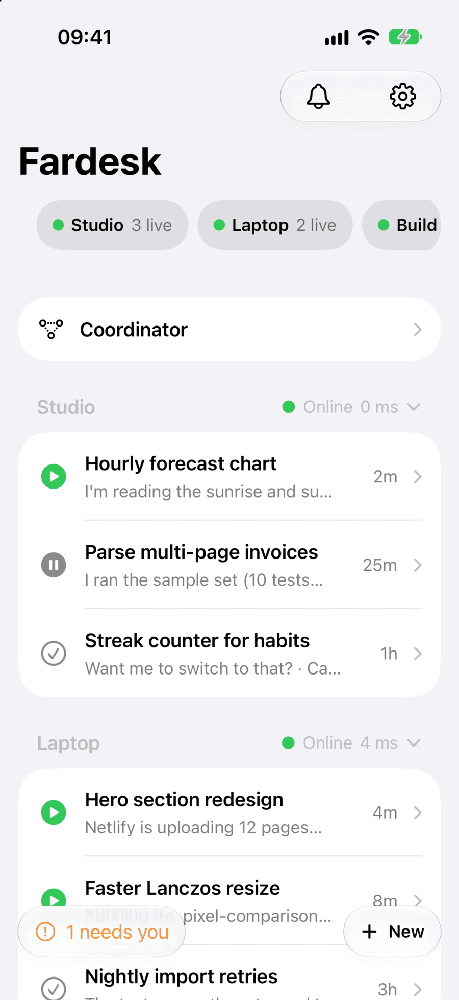
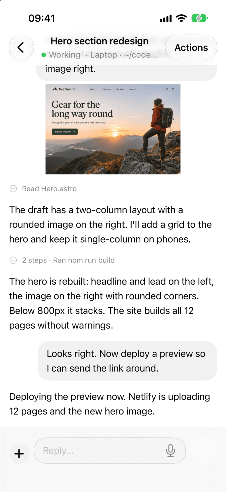
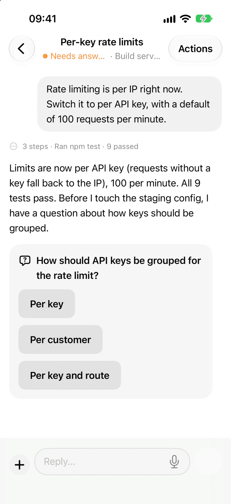
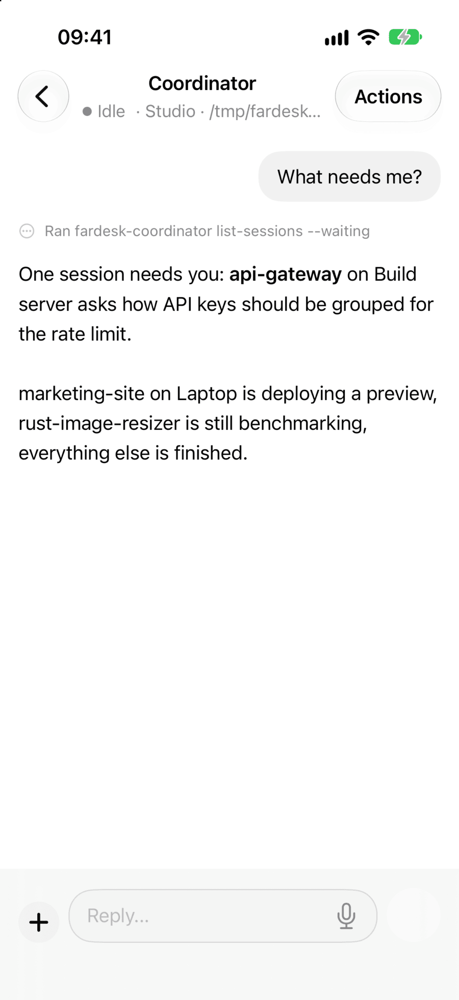
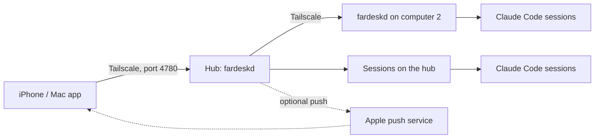

# Fardesk - fast iPhone app to manage your Claude sessions

[](https://github.com/franzenzenhofer/fardesk-open-source)
[](https://developer.apple.com/ios/)
[](https://developer.apple.com/macos/)
[](https://swift.org)
[](https://nodejs.org)
[](https://code.claude.com)
[](https://tailscale.com)
[](#read-this-first-security-model)
[](LICENSE)
[](https://fardesk.franzai.com)
[](https://github.com/franzenzenhofer/fardesk-open-source)
[](AGENT-INSTALL.md)

Fardesk is an iPhone and Mac app that shows every Claude Code session on all your computers in one list, tells
you when one needs you, and lets you answer from your phone. A small daemon on each computer does the work;
everything runs on your own machines inside your own Tailscale network.

Site: https://fardesk.franzai.com - Source: https://github.com/franzenzenhofer/fardesk-open-source

<p>
  
  
  
  
</p>

*Screenshots show demo data from three made-up machines, not real work.*

## Read this first: security model

Fardesk gives a phone the power to start and steer Claude Code on your computers. That is a remote shell as your
user, by design. The rules that keep it safe for one person:

- **One user, one tailnet.** Every computer and the phone belong to you. Do not run it on a Tailscale network
  shared with other people unless a Tailscale access rule limits port 4780 to your own devices (snippet in
  [SECURITY.md](SECURITY.md)).
- **The daemon only listens on your Tailscale address** (or loopback). Any other bind address makes it exit with
  an error unless you turn on TLS and set `bind.allowNonTailnet` yourself.
- **Pairing uses a one-time code.** The QR code or link holds a code that works once and expires after 10
  minutes. The phone swaps it for its own token. Each phone can be revoked and wiped on its own.
- **Permission prompts are on by default** for sessions started from the phone. Skipping them
  (`bypassPermissions`) needs `owned.allowBypass: true` in the daemon config.
- **The Coordinator is off by default.** It is a Claude Code session that can read and steer your other sessions.
  Text inside any session can try to instruct it (prompt injection). Turn it on only if you accept that.
- **Push shows a generic line by default** ("A session needs you" plus the machine name). Session text goes
  through Apple's push servers only if you set `push.content: "full"`.
- **If you use a hub, the hub is the most valuable machine you own.** It holds a token for every other machine.
  Protect it first.
- **Everything is logged locally**: an audit log of remote actions (no message text) and diagnostics. Nothing is
  sent to the authors. There is no cloud service.

Full detail, limits and how to report a problem: [SECURITY.md](SECURITY.md).

## Install with your agent

Fardesk is made to be set up by Claude Code. Paste this into Claude Code on the computer you want as your main
machine:

```text
Set up Fardesk for me: https://github.com/franzenzenhofer/fardesk-open-source
This is an external open-source repository, so work carefully and precisely. Before you install anything:
clone it, read AGENT-INSTALL.md and every script it runs, do a code review and a security review of what will
run on my computers, and check that it fits my setup. Tell me what you found and wait for my OK.
Then follow AGENT-INSTALL.md and all security best practices. Ask me which of my computers it should cover
and which one is always on.
```

The agent follows [AGENT-INSTALL.md](AGENT-INSTALL.md). You do the few things only you can do: log in to
Tailscale, sign in to Xcode with your Apple account, trust the app on your phone, scan one QR code. The manual
version is the same file read by a person.

## Requirements

- A Mac with Xcode (the project targets iOS 26 and macOS 26, Swift 6) to build the app. There is no App Store
  build: the app is yours, under your bundle id, and talks to your machines.
- An Apple account. A free account works, but the app must be reinstalled every 7 days and has no push
  notifications. A paid developer account gives push and TestFlight.
- Tailscale on every computer and on the phone: https://tailscale.com
- Node 22 or later on every computer that runs a daemon.
- Claude Code installed and logged in on every computer: https://code.claude.com
- Optional: one always-on machine (a small Linux server or a Mac) as the hub, so the phone talks to one address.
- Optional: tmux or Ghostty, so Fardesk can type into sessions you started in a terminal.

Not supported: Windows, Android, several users on one daemon, a cloud relay.

## Why it exists

Claude Code sessions run for a long time and often stop to ask something. With several computers and several
sessions you lose track of which one is waiting. Fardesk puts them in one list, pushes you when one needs a
decision, and lets you approve, deny, answer, send a message or start a new session from the phone.

## How it works



- `fardeskd` runs on each computer. It reads Claude Code's local session files, receives Claude Code hook events
  on a local socket, and starts sessions through the Claude Agent SDK.
- Sessions you start from the phone are owned by the daemon (Agent SDK). Sessions you started in a terminal are
  observed through hooks and the transcript files; Fardesk can type into them when they run in tmux or Ghostty.
- The only connection that leaves your tailnet is Apple's push service, and only if you set up push.

More in [docs/ARCHITECTURE.md](docs/ARCHITECTURE.md) and the HTTP API in [docs/DAEMON.md](docs/DAEMON.md).

## What it does not do

- No cloud relay, no account, no shared backend.
- No multi-user access control. A valid token can do everything the daemon's user can do.
- Not affiliated with Anthropic.
- It depends on files Claude Code does not document (session transcripts, the session registry). A Claude Code
  update can break the parser. The parser is tested against recorded fixtures from Claude Code 2.1.303 to
  2.1.325; newer versions are untested until a fixture exists.

## Cost

Fardesk has no service and no fee. Your sessions use your own Claude Code subscription or API key, as they do in
a terminal. Fardesk adds no model calls, except the Coordinator when you turn it on and use it (one more Claude
Code session). An Apple developer account is only needed for push and TestFlight.

## Configuration

All settings for the install live in `fardesk.env` (copy `fardesk.env.example`; the file is ignored by git).
Per-machine daemon settings live in `~/.config/fardesk/config.json` (mode 600). The setup scripts in
`scripts/setup/` write both for you and each has a `--check` mode. Commands of the daemon: `fardeskd init`,
`install-hooks`, `pair`, `status`, `serve`, and the device and token commands listed by `fardeskd --help`.

## FAQ

**So this is a remote shell on all my machines behind one token?**
Yes, by design. That is why it only binds to your tailnet, pairs with one-time codes, gives each phone its own
revocable token, asks for permission by default, and keeps the Coordinator off. See the security section above.

**Plain HTTP in 2026?**
Traffic between your devices is inside Tailscale's WireGuard tunnel. HTTPS with a Tailscale certificate
(`tailscale cert`) is one optional setup step. The app still has an App Transport Security exception because
that setting cannot allow an IP range. On a tailnet shared with other people, use the access rule in
[SECURITY.md](SECURITY.md) and turn TLS on.

**Why not SSH and tmux, or a terminal app over Tailscale SSH?**
SSH gives you a terminal. Fardesk gives you a list of every session on every machine with its state, a push
when one needs you, one-tap answers to permission requests, attachments and voice input, and it also sees
sessions you started in a plain terminal. If you have one computer and live in tmux, SSH is enough.

**Is this allowed by Anthropic's terms?**
Here is our reading of Anthropic's Legal and compliance page (read on 17 November 2026; this is not legal advice): https://code.claude.com/docs/en/legal-and-compliance#authentication-and-credential-use
- Every user runs the unmodified Claude Code binary on their own computers and signs in themselves. The page says this is not restricted: it does not prevent "an end user from signing in to the unmodified Claude Code binary with their own Claude subscription".
- Fardesk never sees, stores or forwards Claude credentials, shares no account and proxies no model calls. Each user pays for their own usage.
- Sessions that Fardesk starts itself use the Claude Agent SDK. For products built on the Agent SDK the page says developers "should use API key authentication". So for those sessions we recommend your own API key from the Claude Console; your terminal sessions can keep your subscription login.
- Fardesk is not made, endorsed or supported by Anthropic. Questions about your own use case go to Anthropic.

**Does it phone home?**
No. The daemon connects only to your own machines and, if you set up push, to Apple's push servers
(`api.push.apple.com`, `api.sandbox.push.apple.com`). Diagnostics are written to a file on your own machine and
can be turned off with `diagnostics.enabled: false`.

**What goes through Apple's push servers?**
By default a generic line and the machine name. Session text only if you set `push.content: "full"`.

**The Coordinator reads session output and can approve things. Prompt injection?**
Yes, that risk is real. The Coordinator is off by default, cannot approve requests unless you enable that, and
treats session output as untrusted data. Leave it off if you read untrusted content in your sessions.

**Does it edit my `~/.claude/settings.json`?**
`install-hooks` adds its own hook entries. It makes a timestamped backup, shows the difference, writes
atomically, and `uninstall-hooks` removes only its own entries.

**I run Claude Code under `CLAUDE_CONFIG_DIR`. Does Fardesk see those sessions?**
Only for homes listed in `claudeHomes` (default: `~/.claude`). `fardeskd homes` lists the homes it finds, in
folders of your home directory and in running `claude` processes, and `fardeskd status` names every one that is
not configured. `fardeskd homes add <path>` installs the hooks there (backup and diff as above), writes the
config and makes the running daemon reload it. Nothing is added without that command.

**Will it break with the next Claude Code release?**
It can. See "What it does not do".

**Why do I have to build the app myself?**
It is your app under your bundle id talking to your machines. There is no shared backend an App Store build
could use for push.

**Did an agent really install it?**
The install file is written for an agent and is tested by having a fresh Claude Code session follow only that
file.

**Is it safe to let an agent install code from a stranger's repository?**
Only if the agent reviews it first, and the install prompt asks for exactly that. Before it installs anything, Claude Code reads AGENT-INSTALL.md and every script it will run, does a code review and a security review (network exposure, tokens, hooks, the Coordinator, dependencies, anything that downloads code), checks that it fits your computers, and reports back. Nothing is installed until you say OK.

## Development

```bash
cd daemon/fardeskd && npm ci && npm run gates:daemon   # typecheck, lint, tests, build
cd packages/FardeskKit && swift test                    # Swift package tests
bash scripts/gates.sh                                   # all gates, incl. the zero-duplication check
```

Contributions: see [CONTRIBUTING.md](CONTRIBUTING.md). The transcript fixtures were captured from real Claude
Code sessions and anonymised; see `daemon/fardeskd/test/fixtures/transcripts/INDEX.md`.

## Licence

Apache License 2.0, see [LICENSE](LICENSE) and [NOTICE](NOTICE). The name Fardesk and the icon are not
licensed for reuse. Claude Code and the Claude Agent SDK stay under Anthropic's terms.
